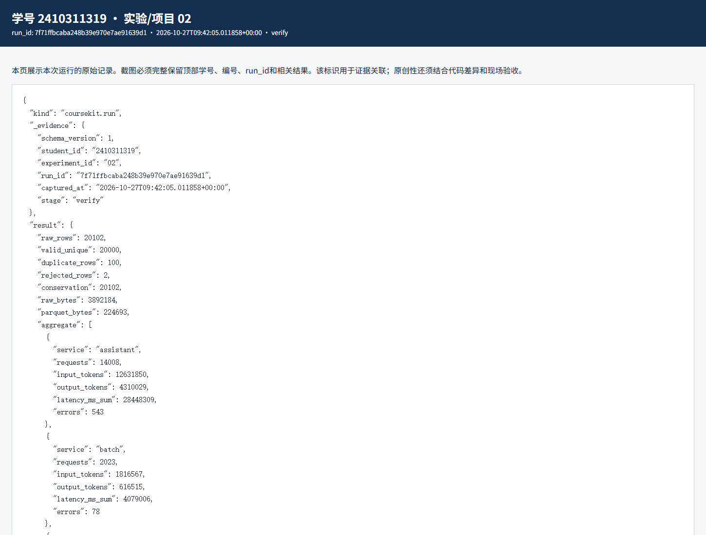
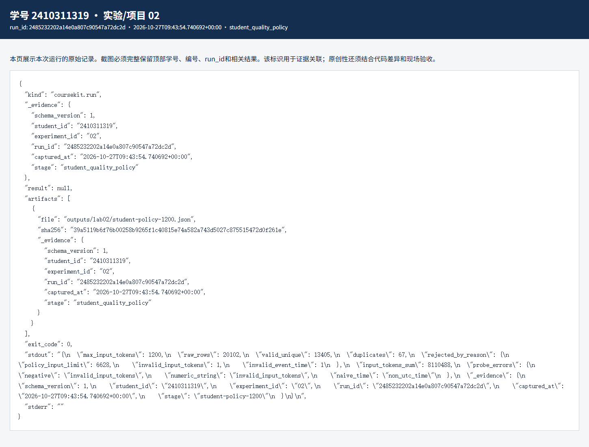

# 实验二 数据湖与质量契约实验报告

实验编号：02　学号：2410311319　姓名：彭博　专业：计算机科学与技术　班级：24计科3　指导教师：刘锦行　实验日期：2026年10月27日

这次我处理的是课程给出的合成服务事件。重点不是把文件转成 Parquet 就算结束，而是要说明原始行去了哪里、异常为什么被剔除，以及改变规则后结果如何变化。

## 一 实验目的

理解原始区、清洗区和汇总区的关系；用质量契约检查字段、时间、重复事件和 token 数；核对清洗前后数量守恒，并用一处明确的规则改动做正反验证。

## 二 实验原理

我把每条原始事件按事件编号、UTC 时间、数值范围等条件检查。合法且首次出现的事件进入 Silver；重复编号单独计数；不合格事件进入隔离记录。这样 20102 条原始记录应满足“有效唯一数＋重复数＋拒收数＝20102”。Silver 用 Parquet 保存，Gold 按 service 聚合，聚合结果还要用独立查询核对。

Parquet 体积变小主要来自列式存储和压缩。文件变小不代表数据质量自动变好，质量判断还是由字段校验、拒收原因和守恒式决定。SHA256 用于核对文件字节是否变化，不能证明数据来源本身可信。

## 三 实验环境与数据

Windows、本课程 Python 3.12 虚拟环境、coursekit、Parquet 与 DuckDB；输入为课程生成的合成事件，不含真实用户记录。基线运行 run_id 为 7f71ffbcaba248b39e970e7ae91639d1。

## 四 实验步骤与运行结果

1. 先运行 lab02 生成清洗结果。原始记录 20102 条，其中有效唯一 20000 条、重复 100 条、拒收 2 条；20102＝20000＋100＋2。两条拒收分别是负数 input_tokens 和无法解析的时间。原始文件 3892184 字节，Silver Parquet 为 224693 字节，单看这两个文件约缩小 94.2%。

2. 接着按 service 对照 Gold：assistant 14008 次、batch 2023 次、search 3969 次，总数恰好为 20000。三个服务的输入 token 合计 18015640，输出 token 合计 6145862；独立查询得到相同总量。这一步是为了避免清洗文件正确、汇总文件却漏行。

3. 在提供的质量规则脚本中，把 input_tokens 上限从 2000 调到 1200，并把原本测试用的布尔值改为字符串“100”，让负例仍然检验类型问题。改动后有效唯一 13405、重复 67、因上限被拒 6628，另有原始异常 2 条；13405＋67＋6628＋2 仍等于 20102。输入 token 合计降到 8110488。这个变化说明拒收规则确实被执行，并非只改了报告数字。

4. 最后重读 Silver manifest 并计算文件哈希。记录 source_sha256、silver_sha256 和 20000 行，确认基线文件与清单一致。个人规则变式只在独立脚本中运行，未拿它覆盖后续实验所需的共同 Silver 基线。

| 项目 | 基线 | 规则上限 1200 |
|---|---|---|
| 有效唯一 | 20000 | 13405 |
| 重复 | 100 | 67 |
| 拒收 | 2 | 6630 |
| 输入 token 合计 | 18015640 | 8110488 |

对应原始记录：[JSON](evidence/7f71ffbcaba248b39e970e7ae91639d1-verify.json) · [HTML](evidence/7f71ffbcaba248b39e970e7ae91639d1-verify.html)

对应原始记录：[JSON](evidence/2485232202a14e0a807c90547a72dc2d-student_quality_policy.json) · [HTML](evidence/2485232202a14e0a807c90547a72dc2d-student_quality_policy.html)

## 五 结果分析与讨论

上限降低后，有效行少了 6595 条，拒收数明显增加；重复数也从 100 变成 67，因为有些原本会被判成重复的记录先被新规则拒绝。由此可见，质量指标不仅取决于规则本身，还取决于校验顺序。不能把这组变式的数量直接说成原始数据“更脏”。

本次使用的是课程合成数据。守恒式、哈希和独立聚合能发现一部分处理错误，但它们不能单独说明字段定义是否符合真实业务，也不能取代源头授权和人工抽查。

## 六 思考题

1. 为什么要保留隔离记录？因为只留下 20000 条好数据会掩盖丢弃原因；记录行号和错误类型，后续才能复核规则是否过严。

2. 为什么不同上限下重复数也会变？去重只在通过前面检查的记录中发生，较早被拒收的行不会再计入后续重复。

## 七 实验总结

本次完成了从原始事件到 Silver、Gold 的检查，也验证了规则调整会怎样改变结果。最有用的不是某个压缩率，而是每一步都有可追的数量和原因。

## 八 资料与提交说明

课程资料：https://gitee.com/ryukinkou/BDP/ 。本实验仓库目录：https://github.com/Pb-Carl/-/tree/main/submissions/lab02。

本报告使用 AI 助手协助整理文字、调整局部代码和执行验证；数值和截图来自所附原始运行记录，教师复核另行进行。
