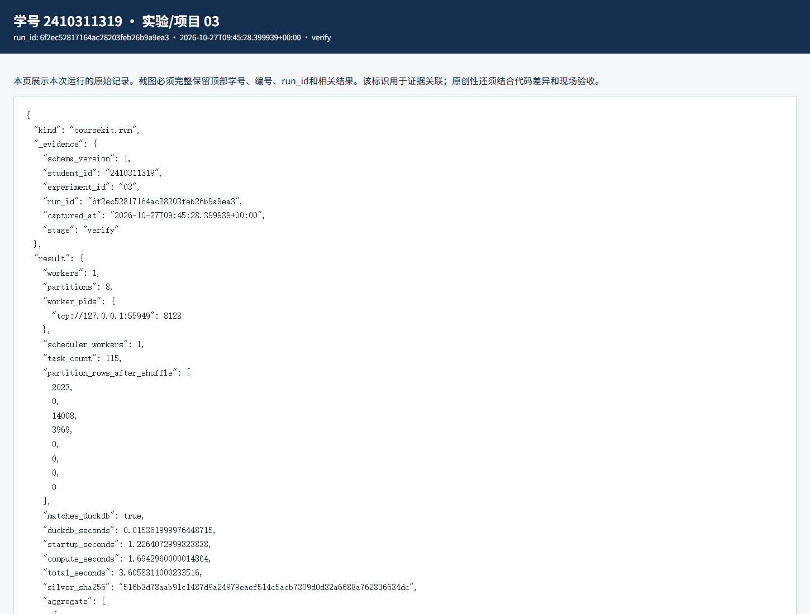
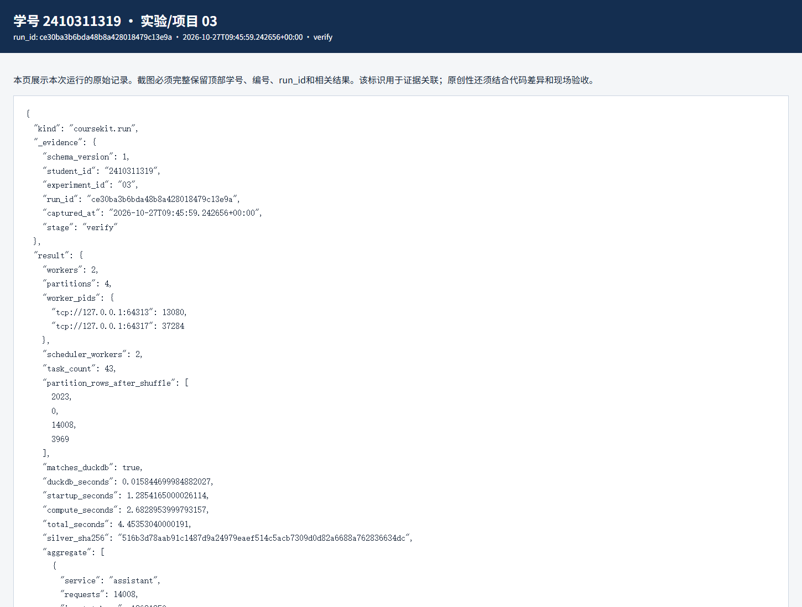

# 实验三 分布式批处理与性能分析实验报告

实验编号：03　学号：2410311319　姓名：彭博　专业：计算机科学与技术　班级：24计科3　指导教师：刘锦行　实验日期：2026年10月27日

实验三把上一章的 20000 条 Silver 数据交给 Dask 处理。我主要比较任务划分、实际运行时间和结果正确性，避免只看“用了两个 worker”就判断性能变好了。

## 一 实验目的

理解单机多进程 Dask 的分区与调度；用独立 SQL 核对聚合；比较不同 worker、partition 配置的耗时；扩展慢请求统计并检验错误率。

## 二 实验原理

Dask 把 Parquet 读成多个分区，再把聚合任务分发给 worker。worker 数、分区数增加会带来更多并行机会，也会增加进程启动、通信和任务调度成本。因此这次记录启动、计算和总耗时，不把某一次运行当成通用性能结论。

慢请求率以各服务请求数为分母；错误率同样以各服务请求数为分母。把阈值从 1000 ms 提高到 2000 ms 后，慢请求数应该减少，原始错误数不应变化。DuckDB 独立统计用于核对 Dask 结果。

## 三 实验环境与数据

Windows、本课程 Python 3.12 环境、Dask 本机 LocalCluster、DuckDB；输入为实验二共同基线的 20000 条 Silver Parquet。不同配置逐次独立运行。

## 四 实验步骤与运行结果

1. 先用 1 worker、8 partitions 运行：实际任务数 115，分区行数为 2023、0、14008、3969、0、0、0、0，计算约 1.694 秒，总耗时约 3.606 秒。Dask 聚合与 DuckDB 结果一致。

2. 再用 2 worker、8 partitions 运行，任务数仍为 115，计算约 3.308 秒，总耗时约 5.407 秒；改为 2 worker、4 partitions 后，任务数降到 43，计算约 2.683 秒，总耗时约 4.454 秒。两次结果仍与 SQL 一致。数据实际上只有三个非空服务分区，8 个分区中有 5 个为空，这解释了增加分区未必有收益。

3. 个人脚本先按 1000 ms 统计，再把慢请求阈值改为 2000 ms，并增加 errors、error_rate，独立 SQL 做同口径验证。2000 ms 时 assistant、batch、search 的慢请求分别为 7120、1011、2041；错误分别为 543、78、179。三组慢请求率约为 50.83%、49.98%、51.42%，错误率约为 3.88%、3.86%、4.51%。

4. 故意设置 workers=0 时程序报 ValueError，限制为 1—4。这个失败说明参数检查生效；恢复合法参数后重新运行，不能用失败截图代替正常结果。

| 配置 | 任务数 | 计算耗时 s | 总耗时 s | SQL一致 |
|---|---|---|---|---|
| 1 worker / 8 partitions | 115 | 1.694 | 3.606 | 是 |
| 2 workers / 8 partitions | 115 | 3.308 | 5.407 | 是 |
| 2 workers / 4 partitions | 43 | 2.683 | 4.454 | 是 |

对应原始记录：[JSON](evidence/6f2ec52817164ac28203feb26b9a9ea3-verify.json) · [HTML](evidence/6f2ec52817164ac28203feb26b9a9ea3-verify.html)

对应原始记录：[JSON](evidence/ce30ba3b6bda48b8a428018479c13e9a-verify.json) · [HTML](evidence/ce30ba3b6bda48b8a428018479c13e9a-verify.html)

## 五 结果分析与讨论

在这台电脑和这批小数据上，1 worker 的一次总耗时反而最短。可以解释为多进程启动和调度开销抵消了并行收益，但不能据此断言 Dask 在更大数据上也更慢。比较时我更看重结果一致、任务数和分区负载，而不是挑最快的一次数字。

阈值提高后，慢请求比例下降符合预期；错误数没有随着阈值变化，说明两类指标各有定义。三个服务平均延迟接近 2 秒，但平均值也不能代替尾延迟，后续真实接口实验另测 p50、p95。

## 六 思考题

1. 为什么 8 partitions 可能比 4 partitions 慢？这批数据按服务聚合后只有三个非空分区，其余任务仍有调度成本。

2. 为何要用 DuckDB 再算一遍？同一段 Dask 代码重复运行只能证明它稳定；独立实现同口径聚合更容易发现漏列、漏组或计算定义错误。

## 七 实验总结

完成了三组 Dask 配置和一处统计扩展。此次小数据没有显示增加 worker 的速度收益，但结果一致、负载不均和调度开销都有实际证据。

## 八 资料与提交说明

课程资料：https://gitee.com/ryukinkou/BDP/ 。本实验仓库目录：https://github.com/Pb-Carl/-/tree/main/submissions/lab03。

本报告使用 AI 助手协助整理文字、调整局部代码和执行验证；数值和截图来自所附原始运行记录，教师复核另行进行。
