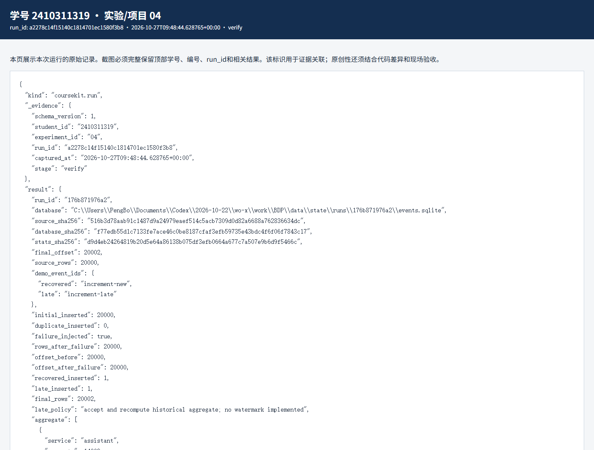
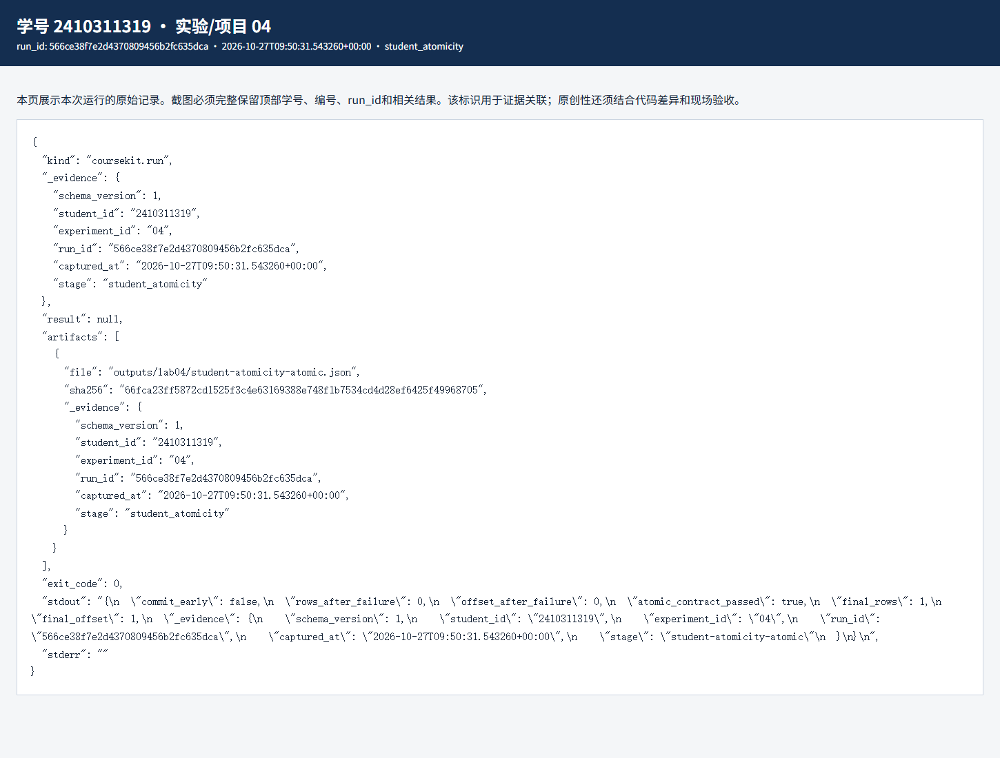

# 实验四 增量事件处理与故障恢复实验报告

实验编号：04　学号：2410311319　姓名：彭博　专业：计算机科学与技术　班级：24计科3　指导教师：刘锦行　实验日期：2026年10月27日

实验四不再从头算整批数据，而是把事件逐条写入 SQLite，并把处理进度和数据一起保存。我重点检查故障发生时能否回滚，以及重放后会不会多算。

## 一 实验目的

理解增量处理、事件主键、检查点和事务边界；注入提交前故障，比较错误与正确事务写法；核对晚到事件和最终汇总。

## 二 实验原理

增量程序以 event_id 防重复，检查点记录已处理位置。写入事件和推进检查点必须在同一事务提交；如果先提交事件、再写检查点，故障后重跑虽然可能靠主键阻止重复，但状态已经不能代表同一原子批次。

课程的晚到策略是接收并重算，没有真实生产系统常用的 watermark。这里能验证本机 SQLite 事务和重放，不代表跨进程、跨机器的 exactly-once。

## 三 实验环境与数据

Windows、SQLite、本课程 Python 环境；上游为 20000 条 Silver 合成事件。当前数据库 run_id 为 176b871976a2，保存在 data/state/runs/176b871976a2/events.sqlite。

## 四 实验步骤与运行结果

1. 运行主脚本后，初次插入 20000 条；重复批次插入 0 条。提交前注入故障时，行数仍为 20000，检查点在故障前后也都为 20000；修复重跑后新增 1 条，晚到事件再插入 1 条，最终为 20002 条、检查点 20002。

2. 独立检查 latest.json 指向当前数据库，再读取实际表：20002 行，检查点 20002，服务统计与 Gold 一致。故障前后的状态不是单凭 JSON 文本判断，而是读数据库表和快照对照。

3. 个人事务脚本的错误写法 COMMIT_EARLY=True：故障后已经留下 1 行，检查点仍是 0，原子性检查为 false。改成 COMMIT_EARLY=False 后再运行，故障后 0 行、检查点 0，恢复后 1 行、检查点 1，检查为 true。这组前后对照比只看“最后插入成功”更能说明事务边界。

4. 晚到事件时间为 2026-02-28 23:59:00 UTC，比新增事件早，但课程策略仍接收它并重算。若真实业务需要窗口关闭和迟到容忍时间，还应另行设计 watermark 与补算规则。

| 场景 | 故障后行数 | 故障后检查点 | 恢复后 |
|---|---|---|---|
| 错误的提前提交 | 1 | 0 | 最终 1 行、offset 1 |
| 事务内共同提交 | 0 | 0 | 最终 1 行、offset 1 |
| 主流程 | 20000 | 20000 | 最终 20002 行 |

对应原始记录：[JSON](evidence/a2278c14f15140c1814701ec1580f3b8-verify.json) · [HTML](evidence/a2278c14f15140c1814701ec1580f3b8-verify.html)

对应原始记录：[JSON](evidence/566ce38f7e2d4370809456b2fc635dca-student_atomicity.json) · [HTML](evidence/566ce38f7e2d4370809456b2fc635dca-student_atomicity.html)

## 五 结果分析与讨论

错误版本最后也能到 1 行，因此只查最终行数会漏掉故障时的状态问题。正确版本在故障点同时保留事件数和检查点，恢复后再一起前进。event_id 主键负责幂等，事务负责事件与进度同生同退，二者解决的问题不同。

本机实验没有模拟消息队列确认、多机故障或网络分区。把这里的结果称为“单机数据库内的事务恢复”更准确。

## 六 思考题

1. 为什么只用 event_id 主键还不够？它能挡住重复行，但不能保证检查点与事件在故障时一致。

2. 晚到事件为什么可能改变旧时段统计？按事件时间分组时，它落在较早的窗口；本课接受并重算，所以先前汇总可能被更新。

## 七 实验总结

这次通过故障前后行数和检查点的实际对照，弄清了为什么要把数据和进度放在同一个事务里。

## 八 资料与提交说明

课程资料：https://gitee.com/ryukinkou/BDP/ 。本实验仓库目录：https://github.com/Pb-Carl/-/tree/main/submissions/lab04。

本报告使用 AI 助手协助整理文字、调整局部代码和执行验证；数值和截图来自所附原始运行记录，教师复核另行进行。
