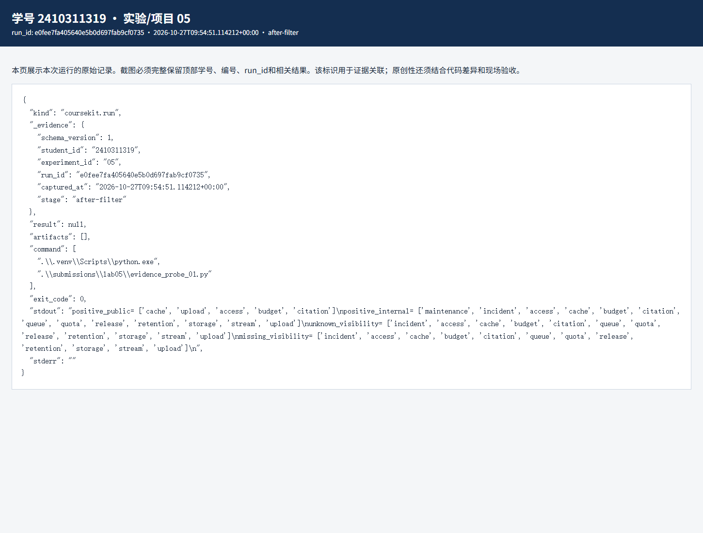
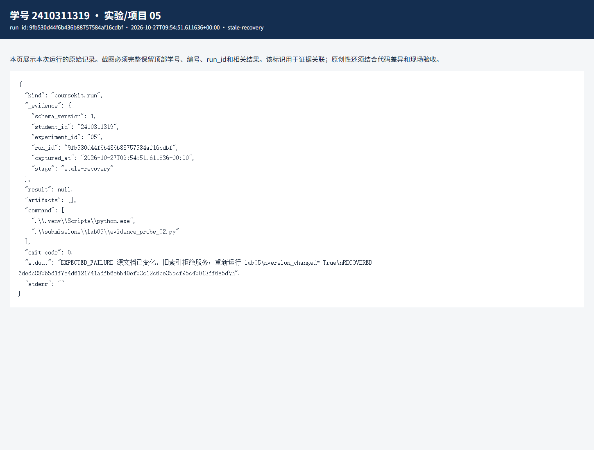

# 实验五 规则文档整理与可解释检索实验报告

实验编号：05　学号：2410311319　姓名：彭博　专业：计算机科学与技术　班级：24计科3　指导教师：刘锦行　实验日期：2026年10月27日

前四次实验处理的是请求数量和 token；实验五开始处理虚构服务规则。我的重点是让检索结果能回到原文，并确认权限写错时不会意外放行。

## 一 实验目的

选择现行规则版本并排除撤回、隔离内容；建立带来源和偏移的词法索引；检查公开与内部角色的检索边界；用临时副本验证旧索引失效。

## 二 实验原理

同一 doc_id 只保留最大 version，再判断 status，避免新版撤回后把旧版复活。切分片段保留 doc_id、version 和字符偏移。中文查询用字符二元组构造 TF-IDF；余弦分数表示本词法空间中的相近程度，不是事实正确的概率。

权限过滤应发生在排序前。只有明确标为 public 或 internal 的片段才有资格成为候选；未知标签既不能给公开角色看，也不能让内部角色直接通过。索引 manifest 记录源文档、统计快照和索引文件的哈希，任何一层字节变化都会触发版本检查。

## 三 实验环境与数据

课程提供 16 条虚构规则记录和实验四的实时统计快照；使用 Python、coursekit 的词法索引，不调用外部大语言模型。本次共同索引版本以 e6a6b9a795a122df0ffa6598e7e4a1bd7de93ab3a08c29f1f0dfb50f6c69c5eb 开头。

## 四 实验步骤与运行结果

1. 从 16 条原始规则中选择出 13 份现行文档，默认切分为 13 个片段。quota 的 v1（60 分钟）被 v2（120 分钟）替换；retired 与 untrusted 不进入索引。查询“缓存键应包含哪些信息”时，TF-IDF 首位是 cache，分数约 0.333，第二位 upload 约 0.152。

2. 改动前，把 maintenance 片段的 visibility 临时改为 partner，internal 查询仍能看到它；标签直接删掉也同样会被看到。修改 search() 后，先限定合法标签，再依据角色筛选；正常公开查询仍有 cache、内部查询仍有 maintenance，而 partner 或缺失标签的 maintenance 不再出现在结果中。测试只改内存索引，没有篡改主语料。

3. 在临时目录复制规则源，给副本末尾加一个空行后调用旧索引验证，得到预期的 StaleIndexError。重新建索引后，版本号发生变化并再次验证通过。一个空行没有改变规则含义，但确实改变了文件字节；课程选择保守的字节级失效策略。

| 检查 | 改动前 | 改动后 |
|---|---|---|
| 正常 public → cache | 命中 | 命中 |
| 正常 internal → maintenance | 命中 | 命中 |
| internal → partner 标签 | 仍可见 | 被排除 |
| internal → 缺失标签 | 仍可见 | 被排除 |

对应原始记录：[JSON](evidence/e0fee7fa405640e5b0d697fab9cf0735-after-filter.json) · [HTML](evidence/e0fee7fa405640e5b0d697fab9cf0735-after-filter.html)

对应原始记录：[JSON](evidence/9fb530d44f6b436b88757584af16cdbf-stale-recovery.json) · [HTML](evidence/9fb530d44f6b436b88757584af16cdbf-stale-recovery.html)

## 五 结果分析与讨论

公开角色没看到内部资料只是最低要求。正例也要能工作，否则把全部结果清空同样能让负例通过。这次同时保留公开、内部正例和未知标签负例，才能说明改动没有把检索功能一起关掉。

词法索引容易复核，但换一种说法时可能找不到原词；RRF 分数也只是排序信号。后面的问答门控不能直接把排序分数当作证据充分性的证明。

## 六 思考题

1. 为什么先选版本再筛状态？若 v2 已撤回，先筛掉它再挑最大版本，会错误地让 v1 重新成为现行规则。

2. 哈希相等能说明什么？说明参与比较的文件字节与记录一致，不能证明审核者可靠，也不能防止有人同时篡改文件和清单。

## 七 实验总结

这次索引不仅能找出相关规则，还能解释引用来自哪份现行文档。修复未知可见性后，权限边界更明确。

## 八 资料与提交说明

课程资料：https://gitee.com/ryukinkou/BDP/ 。本实验仓库目录：https://github.com/Pb-Carl/-/tree/main/submissions/lab05。

本报告使用 AI 助手协助整理文字、调整局部代码和执行验证；数值和截图来自所附原始运行记录，教师复核另行进行。
