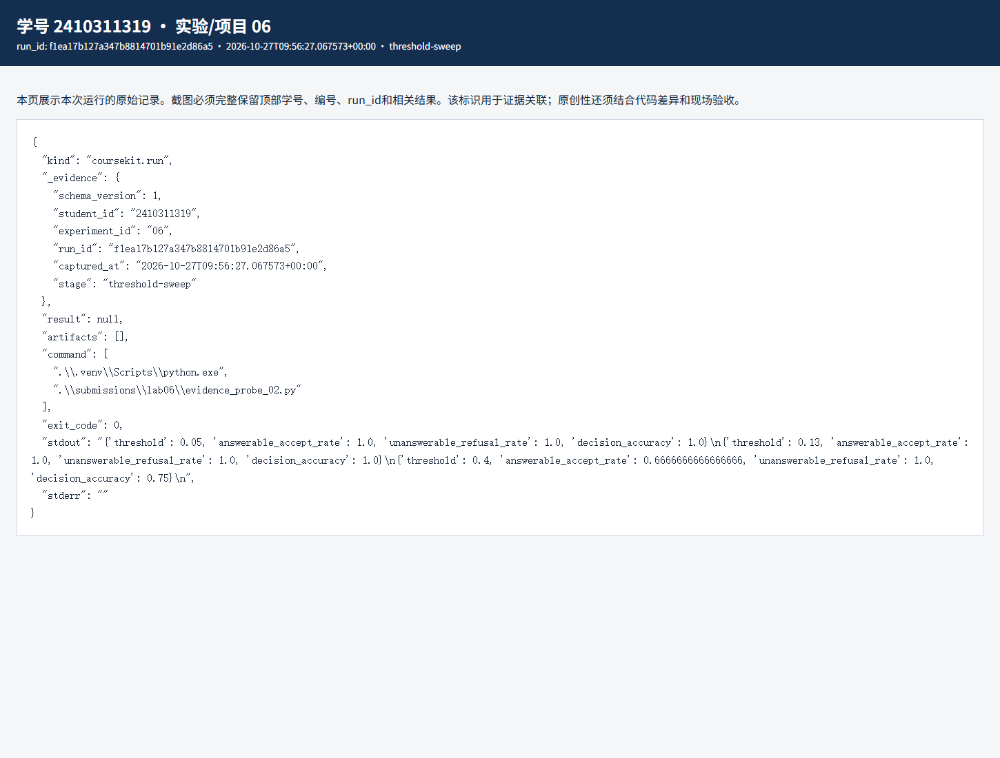
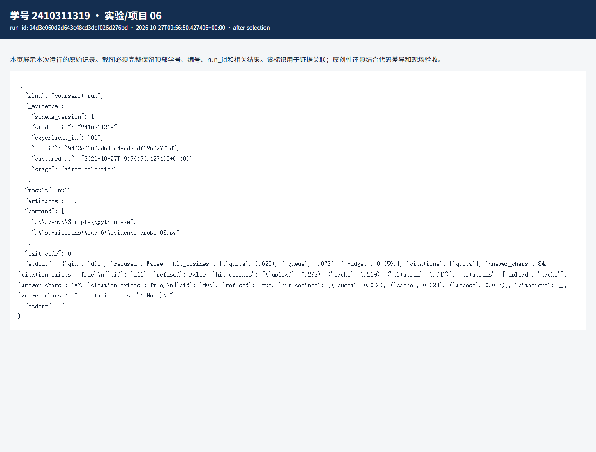

# 实验六 证据查询与结果评价实验报告

实验编号：06　学号：2410311319　姓名：彭博　专业：计算机科学与技术　班级：24计科3　指导教师：刘锦行　实验日期：2026年10月27日

实验五能找到资料，实验六要判断资料是否足够回答。我采用课程的确定式摘录路径，逐题查看引用和拒答；这里没有把摘录称为大语言模型生成。

## 一 实验目的

验证检索、门控、证据选择和引用检查；比较开发集阈值；做单来源、多来源的证据筛选改动；按开发、冻结、测试的顺序记录结果。

## 二 实验原理

先按权限检索，若问题含固定不安全指令或最高片段的 lexical_cosine 低于阈值，就先拒答。可回答题的 Recall@3 以期望来源为分母；不可回答题不参加这一指标，而参加拒答率。引用存在率只核对编号是否来自本次证据，不自动判断句子是否忠于原文。

默认门槛 0.13。原程序把前两条命中直接摘录，我增加了第二条最低词法余弦 0.18 的条件：第一条保留，第二条达标才纳入。这样不改搜索 Top-K，只改交给摘录器的证据集合。

## 三 实验环境与数据

输入为实验五的 13 片段词法索引和课程 24 道合成问题，开发集 12 道、测试集 12 道。使用本机 Python extractive 摘录路径，无 Ollama 推理记录。

## 四 实验步骤与运行结果

1. 先运行开发集基线：12 题中 9 题可回答、3 题不可回答，Recall@3、可回答接受率、不可回答拒答率、门控准确率、引用存在率都为 1.0。再把阈值分别设为 0.05、0.13、0.40：前两个门槛的判定准确率为 1.0，0.40 时可回答接受率降为 2/3，整体准确率 0.75。提高门槛并不保证回答更可靠，它也会挡住本可回答的问题。

2. 改动前，单来源题 d01 的回答同时引用 quota 和相关度只有 0.078 的 queue，长度 180 字符。设置第二条门槛 0.18 后，只剩 quota，长度 84 字符。多来源题 d11 的 upload 和 cache 词法分数分别约 0.293、0.219，改动后两条仍保留，回答长度 187 字符。不可回答题 d05 保持拒答。

3. 完成改动后重新跑开发集，再冻结 code_sha256、索引、题集、阈值和生成器，最后看测试集。测试集 12 题的同组指标也都是 1.0，冻结记录与测试报告的版本一致。这个数字只针对固定合成题集，不代表任意新问题都能正确回答。

| 开发阈值 | 可回答接受率 | 不可回答拒答率 | 判定准确率 |
|---|---|---|---|
| 0.05 | 1.000 | 1.000 | 1.000 |
| 0.13 | 1.000 | 1.000 | 1.000 |
| 0.40 | 0.667 | 1.000 | 0.750 |

对应原始记录：[JSON](evidence/f1ea17b127a347b8814701b91e2d86a5-threshold-sweep.json) · [HTML](evidence/f1ea17b127a347b8814701b91e2d86a5-threshold-sweep.html)

对应原始记录：[JSON](evidence/94d3e060d2d643c48cd3ddf026d276bd-after-selection.json) · [HTML](evidence/94d3e060d2d643c48cd3ddf026d276bd-after-selection.html)

## 五 结果分析与讨论

d01 的第二条证据确实是冗余的，删去后回答更短；d11 的第二个来源没有被误删。这一阈值是根据开发集挑的，不能拿同一批题反复调到最好再宣称泛化。冻结后才读取测试集，且报告保留了修改前后的证据。

引用编号存在还不等于事实忠实；例如把 120 分钟说成 999 分钟再附真实引用，编号检查仍可能通过。人工核对原文和更广的题集仍然需要做。

## 六 思考题

1. 为什么 Recall@3 不给拒答题填 0？这类题没有应命中的正确来源集合，填 0 会把检索召回与拒答边界混在一起。

2. 为什么不把 RRF 分数当成门控值？RRF 根据名次计算，完全不相关的候选也会有正分，分数并非相关概率。

## 七 实验总结

这次把“找到资料”和“应该回答”分开检查。小题集上的指标很好，但单来源摘录冗余、阈值误拒答和引用只验编号等限制也在运行中看到了。

## 八 资料与提交说明

课程资料：https://gitee.com/ryukinkou/BDP/ 。本实验仓库目录：https://github.com/Pb-Carl/-/tree/main/submissions/lab06。

本报告使用 AI 助手协助整理文字、调整局部代码和执行验证；数值和截图来自所附原始运行记录，教师复核另行进行。
