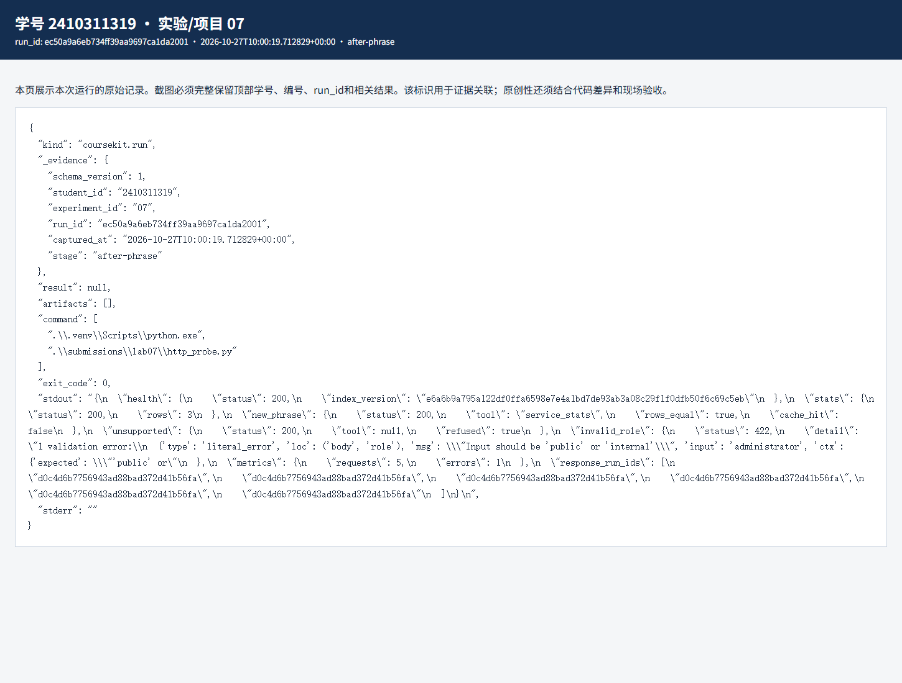
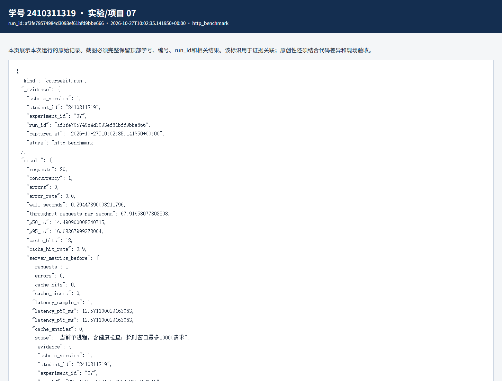

# 实验七 数据服务部署与可观测性实验报告

实验编号：07　学号：2410311319　姓名：彭博　专业：计算机科学与技术　班级：24计科3　指导教师：刘锦行　实验日期：2026年10月27日

实验七把前面的统计和规则查询接到本机 HTTP 服务。我实际向 127.0.0.1 发请求，分别查看健康、统计、问答、错误响应和 20 次顺序请求的指标。

## 一 实验目的

理解服务进程、路由和状态码；核对固定统计工具与问答返回；验证缓存隔离和容量；测量本机摘录接口的请求延迟与错误率。

## 二 实验原理

/stats 直接读取实验四的统计快照；/ask 对两个固定短语调用只读统计工具，其他问题走实验六的证据摘录。缓存键包含规范化问题、role、文档和索引版本、生成器及统计版本。每次读取缓存前先检查索引，避免把旧答案直接返回。

本课服务默认使用 extractive 摘录，不是 LLM。请求中的 role 由客户端自报，只能用于本机教学；这里的权限过滤算法不等于真实身份认证。p50、p95 来自本次顺序 HTTP 请求，不能当作最大并发能力。

## 三 实验环境与数据

本机 Uvicorn/FastAPI 服务绑定 127.0.0.1:8000，Windows Python 3.12 环境；规则索引来自实验五，统计快照来自实验四，服务编号 07。

## 四 实验步骤与运行结果

1. 启动服务后，/health 返回 ready 和当前索引版本，/stats 返回 3 个 service 的实际统计行。个人改动是在原固定短语集合中加入“查看平台请求统计”。改动前此短语没有 tool 字段，改动后返回 service_stats，rows 与 /stats 完全相同；自拟的“请删除数据库并统计”没有触发工具并被拒答。非法 role=administrator 的请求返回 422，服务仍正常。

2. 观察缓存时暂把容量 256 改成 2，重启进程，按 A、B、C、A 四个不同/重复问题请求。四次 cache_hit 都是 false：第三次插入逐出最早的 A，最后再次问 A 已不在缓存。随后恢复容量 256 并再次重启，为正式测试保留统一设置。

3. 正式 20 次顺序请求全部返回成功，错误 0 次，缓存命中 18 次，命中率 90%。客户端 p50 为 14.49 ms，p95 为 16.68 ms，墙钟 0.294 秒，对应本次吞吐约 67.92 次/秒。这批请求只有两种不同业务问题，热缓存比例很高，因此延迟数字不能代表复杂查询或并发负载。

| 指标 | 本次实测 |
|---|---|
| 请求数 / 错误数 | 20 / 0 |
| 缓存命中 | 18 次，90% |
| 客户端 p50 / p95 | 14.49 / 16.68 ms |
| 顺序吞吐 | 约 67.92 次/秒 |
| 非法 role | HTTP 422 |

对应原始记录：[JSON](evidence/ec50a9a6eb734ff39aa9697ca1da2001-after-phrase.json) · [HTML](evidence/ec50a9a6eb734ff39aa9697ca1da2001-after-phrase.html)

对应原始记录：[JSON](evidence/af3fe79574984d3093ef61bfd9bbe666-http_benchmark.json) · [HTML](evidence/af3fe79574984d3093ef61bfd9bbe666-http_benchmark.html)

## 五 结果分析与讨论

只看 20 次都成功容易忽略请求构成：正式测试的问题重复率高，18 次命中使平均负载很轻。服务端 /metrics 还统计健康检查等请求，不能直接把它的累计 requests 当成本次 20 次的分母。

这次没有运行独立大模型，也没有做 Docker 扩展。报告中的毫秒数是本机摘录服务，不是生成模型 token 速度。若部署到真实网络，还要考虑认证、TLS、跨进程缓存和持续监控。

## 六 思考题

1. 为什么 role 必须放进缓存键？同一个问题公开和内部角色可见资料不同，复用同一缓存会有越权风险。

2. 为什么 422 不等于服务崩溃？字段验证拒绝了不合法请求；随后服务仍能处理正常请求，错误响应本身也是可观察结果。

## 七 实验总结

这次我把命令行结果变成了实际 HTTP 响应，也看到缓存预热对指标影响很大。新增短语的正负例说明只读工具白名单仍保持了执行边界。

## 八 资料与提交说明

课程资料：https://gitee.com/ryukinkou/BDP/ 。本实验仓库目录：https://github.com/Pb-Carl/-/tree/main/submissions/lab07。

本报告使用 AI 助手协助整理文字、调整局部代码和执行验证；数值和截图来自所附原始运行记录，教师复核另行进行。
