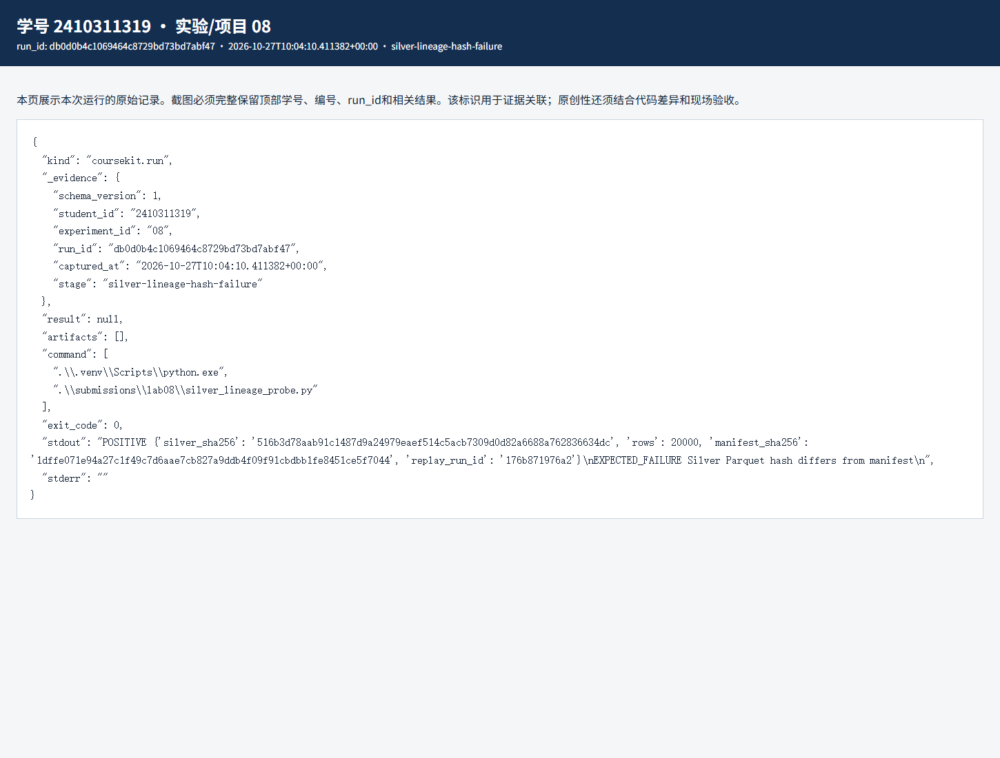
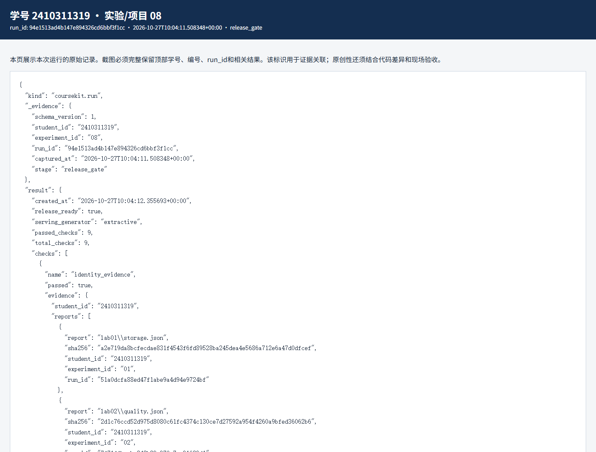

# 实验八 数据治理与可信发布实验报告

实验编号：08　学号：2410311319　姓名：彭博　专业：计算机科学与技术　班级：24计科3　指导教师：刘锦行　实验日期：2026年10月27日

前七次实验的文件都存在，不代表它们一定来自同一批数据和代码。实验八把这些版本关系变成可执行的发布门禁，并给 Silver 数据补上一项血缘检查。

## 一 实验目的

追踪原始数据、清洗文件、数据库、索引、评价和 HTTP 记录的对应关系；运行八项基线检查；新增 Silver 哈希与行数检查，并用临时副本验证失败条件。

## 二 实验原理

发布门禁逐项实际读取文件、计算哈希、执行检索、在数据库副本中重放和回滚，并核对冻结测试与 HTTP 证据。只要一项失败，整体 release_ready 就应为 false。SHA256 证明文件字节与记录匹配，不证明资料审核者身份。

新增 silver_lineage 直接算 data/silver/events.parquet 的 SHA256，先与 data/manifests/silver.json 的 silver_sha256 比，再与 data/state/latest.json 的 source_sha256 比，最后读取 Parquet 元数据核对行数。这样可以发现清洗文件已变但实验四还指向旧数据的情况。

## 三 实验环境与数据

同一 BDP 工作区，实验二 Silver 20000 行、实验四当前数据库 run_id 176b871976a2、实验五词法索引、实验六冻结测试结果和实验七 20 次 HTTP 实测记录。门禁仅覆盖本机 extractive 摘录服务。

## 四 实验步骤与运行结果

1. 先运行课程的八项基线门禁：身份、产物完整性、权限、隔离、版本与缓存、重放与回滚、冻结测试和 HTTP 证据全部通过，8/8，release_ready=true。数据库副本验证的当前行数为 20002、检查点为 20002；重复插入未增加行，故障回滚后原行恢复。

2. 加入第九项 silver_lineage 后，实际 Silver SHA256 为 516b3d78aab91c1487d9a24979eaef514c5acb7309d0d82a6688a762836634dc，行数 20000，与清单及 latest.json 相符。临时复制 Parquet 并追加一个字节，检查立即报“Silver Parquet hash differs from manifest”。主工作区文件没有改动，复验 9/9 通过。

3. 另在临时规则副本中对照隔离状态：untrusted 为 quarantined 时不在索引；改为 approved 后，untrusted 和 INJECTION_SENTINEL_42 都进入索引；恢复 quarantined 后再次消失。这里展示的是审核状态被信任后的检索风险，没有执行资料里的任何指令。

4. 发布说明：当前只可把结果称为“课程本机摘录服务门禁通过”。如果规则文件变动，应重建索引、重跑开发与冻结测试、重测 HTTP，再运行门禁；若 Silver 变动，应先完成质量检查和增量汇总，再顺序更新后面的版本。不能直接手改 manifest 使门禁变绿。

| 检查阶段 | 通过数 | 结果 |
|---|---|---|
| 课程八项基线 | 8/8 | 通过 |
| 加入 Silver 血缘 | 9/9 | 通过 |
| 临时损坏 Silver | 哈希不一致 | 按预期失败 |
| 隔离状态改为 approved | 可检索到 untrusted | 暴露风险 |

对应原始记录：[JSON](evidence/db0d0b4c1069464c8729bd73bd7abf47-silver-lineage-hash-failure.json) · [HTML](evidence/db0d0b4c1069464c8729bd73bd7abf47-silver-lineage-hash-failure.html)

对应原始记录：[JSON](evidence/94e1513ad4b147e894326cd6bbf3f1cc-release_gate.json) · [HTML](evidence/94e1513ad4b147e894326cd6bbf3f1cc-release_gate.html)

## 五 结果分析与讨论

第九项补的是清洗文件与其清单、增量数据库之间的直接关系。原八项已经检查了很多下游版本，但把这个上游关系单列出来，更容易定位是数据层先变了。负例在临时副本中失败、恢复后 9 项通过，比硬写一个 passed=true 更能说明检查确实在运行。

9/9 仍不是生产许可：角色是客户端自报，题集很小，缓存只在一个进程里，数据库是单机 SQLite，固定攻击样本也不能代表全部提示注入变体。真实上线至少还需要服务端认证、外部来源审核、独立监控和更广的测试。

## 六 思考题

1. 为什么哈希匹配不等于来源可信？有人若同时控制资料和清单，两个哈希也可能一致；它只核对当前字节与记录。

2. 为什么单机事务回滚不能叫分布式 exactly-once？这里没有覆盖消息确认、多节点故障和网络分区，结论只限于当前 SQLite 副本。

## 七 实验总结

这次把前面散落的文件关系连接成了可失败的检查。最终九项通过，但报告仍把适用范围限制在课程提供的本机合成场景。

## 八 资料与提交说明

课程资料：https://gitee.com/ryukinkou/BDP/ 。本实验仓库目录：https://github.com/Pb-Carl/-/tree/main/submissions/lab08。

本报告使用 AI 助手协助整理文字、调整局部代码和执行验证；数值和截图来自所附原始运行记录，教师复核另行进行。
